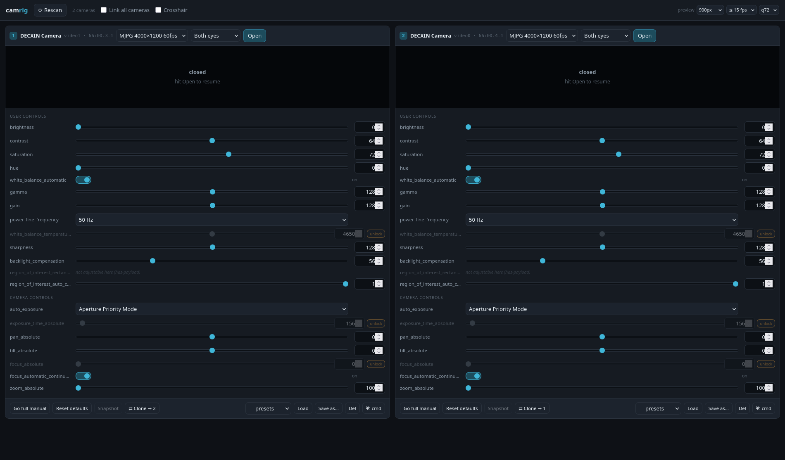

# camrig

Browser control panel for USB (UVC) cameras: a live preview plus every v4l2
control as a slider and a number box, for as many cameras as you have plugged in.

Built for DECXIN stereo cams but device-agnostic — controls are discovered from
the hardware, never hardcoded, so you get whatever the camera actually exposes.



## Install

```bash
./install.sh     # from this folder: deps, the camrig + CamView icons, the ± hotkey
```

It resolves paths at install time, so re-run it if the checkout moves. Two apps
live here: **camrig** (the browser control panel) and **CamView** (`camview.py`,
the native 1:1 viewer app, which imports `camrig.py`: a sidebar of every DECXIN
plugged in, view all of them or click one to view it alone, and cameras can be
plugged and pulled while it runs. Keys and the 60 fps decode notes are in its
docstring: `python3 -s camview.py --help`). Then
double-click **camrig** on your Desktop, or run it directly:

```bash
./run.sh                        # opens http://127.0.0.1:8088
./run.sh --host 0.0.0.0         # also reachable from a phone on the LAN
./run.sh --port 9000
./run.sh --rec-dir /mnt/ssd/rec # where Record writes (default ~/Videos/camrig)
```

Launching twice is safe — if a camrig is already serving, it just reopens the tab
instead of failing on a taken port. The server is pure Python stdlib; OpenCV is
used only to grab and scale frames.

## One panel per camera

Each connected camera gets exactly one panel, with one control stack. Plug another
camera in and a panel appears on its own within a few seconds — no restart, no
Rescan (the button is there if you want to force it). Unplug one and its panel
goes away while the others keep streaming untouched.

Two identical cameras report the same name, so each panel header also shows its
USB port (`video1 · 66:00.3-1`). That is the only thing that ties a panel to a
specific physical unit.

### Stereo cameras get one panel, not two

A side-by-side stereo camera (e.g. DECXIN at 4000×1200 = two 2000×1200 eyes)
exposes **one v4l2 control set for the whole frame**. There is no per-eye
register: brightness, exposure, white balance and gain all apply to both lenses at
once, so the eyes are permanently on identical settings and cannot be tuned
separately or drift apart.

That is why one camera means one panel with one control stack. The panel shows both
eyes together with a dashed seam marking the lens boundary. The **Both eyes /
Left eye only / Right eye only** selector is a *view* zoom for inspecting one lens
— it changes nothing on the hardware.

The practical consequence: a soft or dirty eye can never be corrected with
settings, only cleaned or replaced.

## Controls

Each row has a slider *and* a number box — drag, or type an exact value, or use
arrow keys on the slider for single steps. A dot next to a control's name means it
is off its hardware default. Hover a name for its range, step and flags.

### Auto-mode interlocks

Controls like `exposure_time_absolute`, `focus_absolute` and
`white_balance_temperature` are read-only while an auto mode owns them — v4l2
reports them `inactive` and rejects writes with `EACCES`. Those rows are grayed
out with an **unlock** button that flips the gating control for you.
**Go full manual** does all of them at once.

`Reset defaults` restores every control, including the gated ones: it unlocks the
auto modes, writes the values, then restores the auto modes.

## Recording

**● Record** writes full-resolution video to `~/Videos/camrig`; the **📁 Recordings**
button in the top bar opens that folder, and `--rec-dir` moves it. Click the button
again to stop — while rolling it doubles as the elapsed clock, and the preview carries
a blinking `REC` badge with the duration, which eye, and the file size so far.

Files are **H.264 mp4** by default: ~27 MB/min at 4000×1200, and playable in anything
including a browser. The dropdown beside the button switches to **MJPG avi**, which
keeps every frame as its own JPEG — no interframe smearing of the fine detail you are
usually tuning for — at roughly 300 MB/min. Video only, no audio track.

What the preview shows is what you get, at full sensor resolution: the preview's
downscale and fps cap do not apply. Zoom into one eye and you record only that eye
(2000×1200 for a DECXIN), which is also how the filename is tagged.

Worth knowing:

- **A recording is a wall-clock timeline.** One frame goes out per slot at a fixed
  rate, always the newest available, so 30 s of recording is a 30 s file that stays
  in step with what you watched. If capture hiccups the previous frame is held rather
  than the file quietly coming out shorter.
- **The rate is measured, not requested.** The recorder uses the fps the camera is
  actually delivering when you hit Record, not the mode dropdown's nominal number —
  recording at "60" while 15 arrive would stretch the timeline 4×. Let a freshly
  opened camera settle for a second or two first.
- **If the encoder cannot keep up, camrig says so** instead of handing you a
  silently sped-up clip: the file's own duration is compared against the wall clock
  and you get the percentage. Encoding one 4000×1200 frame costs ~25 ms in H.264 and
  ~32 ms in MJPG, which is the real ceiling — and it lands on top of the ~27 ms
  decode each camera already needs, so watch the `fps real/mode` metric when two
  cameras roll at once.
- **It stops itself and finalizes the file** when the camera is closed, unplugged,
  switched to another mode, or the disk drops under 400 MB free — including on
  `kill` or a closed terminal. That matters: an mp4 or avi abandoned without its
  index plays as a 0-second file.

Recording cannot be handed to ffmpeg here, by the way — only one process can hold a
`/dev/video*` node and camrig is already holding it, so frames come off the capture
thread that is already running.

## Buttons

- **Snapshot** — full-resolution JPEG to `~/Desktop` (just the visible eye if one is selected)
- **● Record** — full-resolution video to `~/Videos/camrig`; see [Recording](#recording)
- **Save as… / Load / Del** — named presets in `presets.json`, shared across cameras
- **⇄ Clone** — copy every control value from this camera onto the other
  camera(s). Reads `Clone → 2` with one other camera, `Clone to all` with more.
  Disabled when only one camera is connected.
- **Link all cameras** — mirror each edit onto every other camera as you make it
- **⧉ cmd** — copy an equivalent `v4l2-ctl --set-ctrl` one-liner

## Metrics

Under each preview: fps, mean brightness, contrast, sharpness (Laplacian
variance), % clipped highlights, and for a stereo frame the left/right sharpness
ratio. Zooming into one eye reports that eye's own sharpness.

**There are three different fps numbers — don't confuse them:**

| Where | What it means |
|---|---|
| Mode dropdown (`MJPG 4000×1200 60fps`) | what camrig *asks the camera for* |
| `≤ 15 fps` in the top bar | a cap on how many frames are pushed to the browser |
| `fps real/mode` metric | **left = what is really being delivered. Trust this one.** |

Requesting 60 does not get you 60. Decoding one 4000×1200 MJPEG frame costs ~27 ms
on its own, so ~25 fps is the practical ceiling for that mode — and roughly halves
again per additional camera, since each one needs its own decode. Two DECXINs run
about 15 fps each. The metric goes amber when delivery falls well below the
requested mode.

The L/R ratio is only meaningful when both eyes see similar content — a QR code or
window in one eye's field of view alone will skew it hard.

## Notes

- A camera can only be held by one app at a time. If it is busy, camrig names the
  process holding it (e.g. `realsense-viewer`) instead of failing silently. It
  ignores its own handle.
- Preview is downscaled and frame-capped so the browser stays smooth; snapshots
  are always full resolution. Raise `preview` in the top bar for more detail, or
  lower it when running several cameras.
