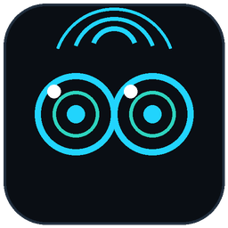

# StarCap Finder

A double-click app that lists every StarCap recorder reachable from your laptop
and opens the one you click. No IP addresses to remember, no upload server, no
cloud, no internet — plug in the ethernet cable and the boards show up.

Clicking a card opens that recorder's normal dashboard (live stereo preview,
record button, stats, recordings) — the same page it already serves on `:8080`.



## Install (Ubuntu)

```bash
tar xzf starcapfinder.tar.gz
cd starcapfinder
./install.sh
```

That's it — no `pip install`, no dependencies beyond the `python3` Ubuntu ships
with. You now have a **StarCap Finder** icon in the app grid and on the Desktop.
Double-click it and your browser opens on the device list.

Moved the folder? Re-run `./install.sh`. Want the launchers gone?
`./install.sh remove`.

Prefer a terminal:

```bash
./run.sh                 # http://127.0.0.1:8090
./run.sh --port 9100     # different port
./run.sh --no-browser    # just serve it
```

## How it finds boards

1. **UDP roll-call** — broadcasts `STARCAP_PEER_DISCOVER v1` on `udp/18793`.
   Every recorder answers with its identity. Takes about a second, and repeats
   every 2.5 s so the list stays live.
2. **Subnet sweep** — fallback that probes `:8080/api/version` across your local
   `/24`s. Runs automatically if the first roll-call finds nothing, and any time
   you hit **Rescan network**. Slower (a few seconds) but it finds boards whose
   broadcast reply got eaten by a switch or AP.

Wired boards sort first and get an `ethernet` badge, so on a laptop that's on
wifi *and* the capture LAN it's obvious which boards are actually docked.

Live stats (fps, temperature, disk, uptime, pending uploads) are fetched by the
app itself rather than by the page, because the recorder's API sends no CORS
headers. Preview thumbnails are plain MJPEG `` streams, which need none.

## 🎵 Sing — مزمار عبد السلام on a board's buzzer

Every card has a **🎵 Sing** button that plays the mizmar tune on that recorder's
own buzzer. Handy for picking one board out of a rack by ear, and for proving a
buzzer still works.

**No firmware change, nothing deployed to the fleet.** It's the same trick
opm-name uses to identify a board while renaming it
(`starcap-ops/fleet/opm-name/opmname.py`): SSH in, stop the `stereocam` service so the
GPIO line is free, drive pin 15 (`gpiochip0` line 28) with the very same `lgpio`
calls the firmware's `webui/buzzer.py` uses, then start the service again. The
board is offline for a few seconds; the melody lives here, in `starcapfinder.py`.

The button refuses rather than doing something rude:

| the card says | why |
| --- | --- |
| `🎵 no buzzer` | that board has no buzzer hardware — **NanoPi R76S**, which also has no `lgpio`. Orange Pi 5 only. |
| greyed, "recording" | it's mid-take. Stopping `stereocam` would interrupt a real shoot, so it won't. Checked live at click time, not from the card's last poll. |
| `🎵 failed` | hover it — the reason is the tooltip (no answer, `sshpass` missing, SSH refused…). |

If the tune itself crashes, the service is still restarted (the on-board script
deliberately runs without `set -e`) — a bad note must never leave a field
recorder with `stereocam` down.

### Tuning it by ear

You don't need a board. `preview_mozmar.py` renders the exact same frames to a
50%-duty square wave — which is literally what the PWM buzzer produces — and
plays it on your laptop:

```bash
./preview_mozmar.py                # hear it
./preview_mozmar.py --tempo 240    # slower (base note in ms; default 200)
./preview_mozmar.py --notes        # numbered frame list, for saying what's wrong
./preview_mozmar.py --wav out.wav  # just write the file
```

The melody is the `MOZMAR` list in `starcapfinder.py` — `(freq_hz, ms)` frames,
grouped into four commented phrases plus a tag, in maqam Hijaz on D. It uses raw
Hz rather than tempered notes on purpose (the mizmar's second sits sharp of a
real E♭). It's the same frame format as the firmware's `JINGLES`, so anything
you tune here can be pasted into `webui/buzzer.py` later if it should ever
become a real recorder sound.

## Works with

- **Orange Pi 5** and **NanoPi R76S** — both run the same `main` firmware, and
  the discovery responder isn't board-specific, so both answer identically.
- Recorder firmware **v1.0.7 or newer** for the instant roll-call. Anything
  older predates peer discovery, but **Rescan network** still finds it, since
  the sweep only needs `/api/version`.

## If nothing shows up

- Ethernet seated at both ends, board powered and ~30 s past boot?
- Hit **Rescan network** to force the full sweep.
- Check you're on the same subnet as the boards: `ip -4 addr`.
- Verify a board by hand: `curl http://<ip>:8080/api/version` should say
  `"service": "stereocam"`.
- Some corporate/guest APs block UDP broadcast entirely — the sweep is the
  workaround there.

## Config (env vars)

| var | default | meaning |
| --- | --- | --- |
| `FINDER_PORT` | `8090` | local web UI port |
| `DEVICE_PORT` | `8080` | recorder dashboard port |
| `PEER_PORT` | `18793` | discovery port |
| `FINDER_SUBNETS` | auto | comma list of `/24` prefixes to sweep, e.g. `10.77.0,192.168.8` |
| `PI_USER` / `PI_PASS` | `orangepi` / `orangepi` | recorder SSH login, for 🎵 |
| `MOZMAR_TEMPO_MS` | `200` | base note length — the one tempo knob |
| `BUZZER_CHIP` / `BUZZER_LINE` | `0` / `28` | buzzer GPIO (pin 15), same defaults as the firmware |
| `BUZZER_ACTIVE_LOW` | `0` | set `1` if a board is wired +3.3V→buzzer→pin |

## Files

| file | what |
| --- | --- |
| `starcapfinder.py` | the whole app — discovery, local web server, UI, the `MOZMAR` melody |
| `preview_mozmar.py` | hear the melody on your laptop, no board needed |
| `run.sh` | launcher used by the desktop icon |
| `install.sh` | writes the `.desktop` entries for this machine |
| `icon.png` | app icon |
